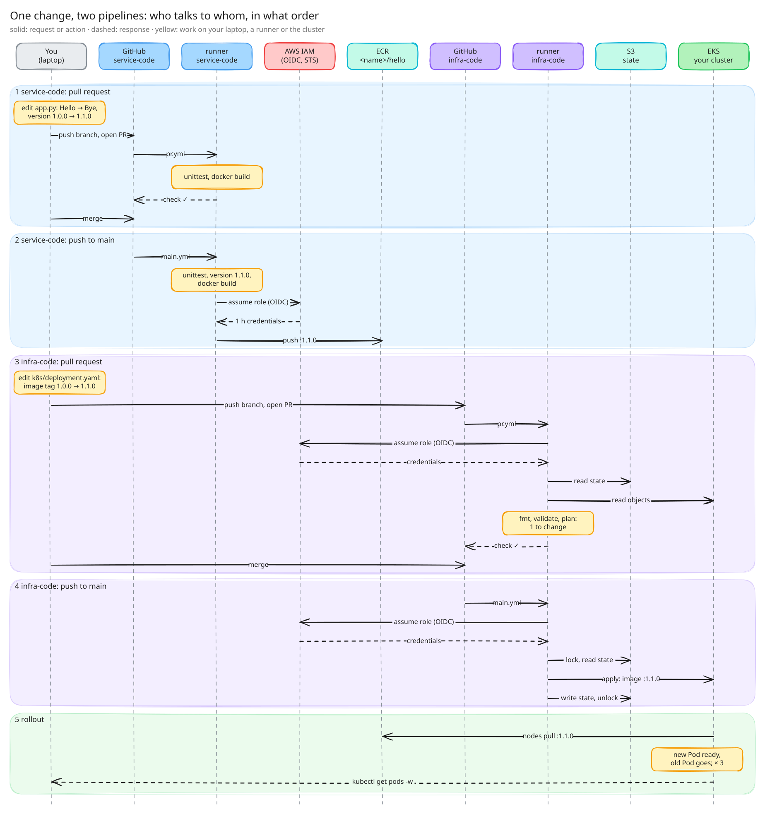

# CI/CD for service code and infrastructure code

DevOps CSK · 2026-11-10, 17:00–19:00

Goal: a change in `service-code` reaches your EKS cluster through two pipelines: build and push the
image, then deploy it with Terraform. No manual `kubectl apply`.



Editable: [`diagram/sequence.excalidraw`](diagram/sequence.excalidraw) (excalidraw.com → Open).

## Repos

| your repo | create it from template |
|---|---|
| `service-code` | https://github.com/kohanyirobert/csk-w10-service-code |
| `infra-code` | https://github.com/kohanyirobert/csk-w10-infra-code |

## Prerequisites

- AWS CLI v2 logged in to `devops-csk2`, Terraform ≥ 1.10, Docker, `kubectl`, `uv`, a GitHub account.
- Prefix every AWS resource with your name (shared account, IAM names are global).
- Use your region (a region allows 5 VPCs):

| name | region |
|---|---|
| andras | `eu-west-1` |
| atilla | `eu-west-2` |
| csepella | `eu-west-3` |
| daniel | `eu-north-1` |
| richard | `eu-central-1` |
| gergely | `us-east-1` |
| kris | `us-east-2` |
| lorand | `us-west-1` |
| szino | `us-west-2` |
| robi (demo) | `eu-west-1` |

## 0. Repos and state bucket

Result: `<you>/service-code` and `<you>/infra-code` on GitHub, cloned; an S3 bucket for the state;
`terraform init` works in `infra-code`.

1. On both template pages: Use this template → Create a new repository, public, your account. Not
   a fork: forks start with Actions disabled.
2. Create the state bucket by hand, with versioning:
   ```bash
   aws s3api create-bucket --bucket <name>-csk-w10-tfstate --region <region> \
     --create-bucket-configuration LocationConstraint=<region>
   aws s3api put-bucket-versioning --bucket <name>-csk-w10-tfstate \
     --versioning-configuration Status=Enabled
   ```
   In `us-east-1`, leave out `--create-bucket-configuration`.
3. Replace the `CHANGE-ME`s in `infra-code/main.tf`, run `terraform init`.

## 1. infra-code: EKS, ECR, GitHub roles

Result: an EKS cluster with 2 nodes, an ECR repository, a `hello` namespace, two IAM roles for
GitHub Actions. Applied from your laptop. No Deployment, no workflow yet.

The cluster takes ~15 minutes: start `terraform apply`, do step 2 meanwhile. If `apply` times out,
run it again: it continues where it stopped.

Suggested files:

### `main.tf` (given)

- Backend values are literals: a `backend` block can't use variables.
- `provider "aws"`: no `profile`. On your laptop `export AWS_PROFILE=...`; on the runner the
  credentials come from the OIDC login. A hard-coded profile breaks the pipeline.
- Optional: `default_tags { tags = { owner = "<name>" } }` tags everything the provider creates.

### `variables.tf`, `terraform.tfvars`

- `name`, `region`, `github_owner`. Commit `terraform.tfvars`: nothing in it is secret, and the
  runner needs the same values.

### `network.tf`

- `aws_vpc` `10.0.0.0/16` with `enable_dns_support` and `enable_dns_hostnames` = `true`. Without
  DNS, nodes can't join the cluster.
- 2 subnets in 2 different AZs: EKS refuses a cluster in one AZ.
  `data "aws_availability_zones" "available" { state = "available" }`, take the first two with
  `slice(...names, 0, 2)`. Subnet CIDRs: `cidrsubnet(aws_vpc.this.cidr_block, 8, count.index)`.
- `map_public_ip_on_launch = true`. There is no NAT gateway, so a node without a public IP can't
  reach the EKS API or ECR: the node group fails with `NodeCreationFailure`.
- `aws_internet_gateway`, `aws_route_table` with `0.0.0.0/0` → gateway, and an
  `aws_route_table_association` for **each** subnet. A missing association is the same failure.

### `eks.tf`

- Cluster role: trust `eks.amazonaws.com` with actions `sts:AssumeRole` and `sts:TagSession`; attach
  `AmazonEKSClusterPolicy`.
- `aws_eks_cluster`: `vpc_config.subnet_ids` = both subnets;
  `depends_on` the policy attachment, or on destroy the role loses its policy before the cluster is
  gone.
- `access_config { authentication_mode = "API", bootstrap_cluster_creator_admin_permissions = true }`:
  whoever runs the first `apply` becomes cluster admin. That must be you, from the laptop. Changing
  it later replaces the cluster.
- Leave out `version`: you get the current default.
- Node role: trust `ec2.amazonaws.com`, attach `AmazonEKSWorkerNodePolicy`, `AmazonEKS_CNI_Policy`,
  `AmazonEC2ContainerRegistryReadOnly` (without the last one: `ImagePullBackOff` in step 4).
- `aws_eks_node_group`: `t3.medium`, `scaling_config` min 1, desired 2, max 3; `depends_on` the node
  policy attachments and the route table associations (nodes need the internet to join, and on
  destroy the routes must outlive the nodes).
- IAM role names are global in the account: `<name>-eks-cluster`, `<name>-eks-node`.

### `ecr.tf`

- `aws_ecr_repository` `<name>/hello`. The `/` is fine, it's only part of the name.
- `image_tag_mutability = "IMMUTABLE"`: a tag can be pushed once. Every release needs a new version.
- `force_delete = true`, or `destroy` fails while images are in it.

### `github-oidc.tf`

How it works: every workflow run can ask GitHub for a signed token (needs `id-token: write` in the
workflow). AWS checks the signature against the account's OIDC provider, then checks the role's
trust policy against the token's claims, and returns credentials valid for an hour.

- The provider exists once per account, and `devops-csk2` has it. Use
  `data "aws_iam_openid_connect_provider" "github" { url = "https://token.actions.githubusercontent.com" }`.
  A `resource` fails with `EntityAlreadyExists`, and destroying it would break everyone.
- Write trust policies with `data "aws_iam_policy_document"`:
  - action `sts:AssumeRoleWithWebIdentity`, principal `Federated` = the provider's ARN;
  - `StringEquals` `token.actions.githubusercontent.com:aud` = `sts.amazonaws.com`;
  - `StringEquals` `token.actions.githubusercontent.com:sub` = the allowed values.
- `sub` depends on the event: a push to `main` is `repo:<owner>/<repo>:ref:refs/heads/main`, a pull
  request is `repo:<owner>/<repo>:pull_request`. Owner and repo exactly as on GitHub. Don't use
  `StringLike` with `*`: `repo:*` lets any GitHub repo in.

| role | allowed `sub` | permissions |
|---|---|---|
| `<name>-gha-service` | `repo:<you>/service-code:ref:refs/heads/main` | `ecr:GetAuthorizationToken` on `*`; `ecr:BatchCheckLayerAvailability`, `ecr:InitiateLayerUpload`, `ecr:UploadLayerPart`, `ecr:CompleteLayerUpload`, `ecr:PutImage`, `ecr:BatchGetImage`, `ecr:GetDownloadUrlForLayer` on your repo's ARN |
| `<name>-gha-infra` | `repo:<you>/infra-code:pull_request`, `repo:<you>/infra-code:ref:refs/heads/main` | `AdministratorAccess` (it applies this whole configuration: VPC, EKS, IAM) |

- IAM lets the infra role into AWS, not into Kubernetes. Add `aws_eks_access_entry` for the role and
  `aws_eks_access_policy_association` with
  `arn:aws:eks::aws:cluster-access-policy/AmazonEKSClusterAdminPolicy`, `access_scope { type = "cluster" }`.
  Without it the runner's plan fails with `Unauthorized`.

### `k8s.tf`

- `kubernetes` provider, logging in like `kubectl`:
  ```hcl
  provider "kubernetes" {
    host                   = aws_eks_cluster.this.endpoint
    cluster_ca_certificate = base64decode(aws_eks_cluster.this.certificate_authority[0].data)
    exec {
      api_version = "client.authentication.k8s.io/v1beta1"
      command     = "aws"
      args        = ["eks", "get-token", "--cluster-name", aws_eks_cluster.this.name, "--region", var.region]
    }
  }
  ```
- `exec` runs the `aws` CLI: it must be installed wherever Terraform runs, with the same
  credentials.
- `kubernetes_namespace_v1` `hello`. It can be in the same first `apply` as the cluster.

### `outputs.tf`

- `service_role_arn`, `infra_role_arn`, `ecr_repository_url`: they go into the repo variables.
- Handy: the `aws eks update-kubeconfig --name ... --region ...` command as an output.

Check:

```bash
aws eks update-kubeconfig --name <cluster> --region <region>
kubectl get nodes      # 2 Ready
kubectl get ns hello
```

## 2. service-code: Dockerfile and workflows

Result: a `Dockerfile`; `pr.yml` runs the tests and builds the image on PRs to `main`; `main.yml`
runs the tests, builds the image, tags it with the version from `pyproject.toml` and pushes it to
ECR, on pushes to `main`.

Add them on a branch, open a PR, merge. The `main.yml` run fails at the AWS login until step 1 is
done.

Dockerfile:

- `FROM python:3.13-slim`, `COPY --from=ghcr.io/astral-sh/uv:0.11 /uv /bin/`.
- Copy `pyproject.toml` and `uv.lock`, `RUN uv sync --locked --no-install-project`, then copy
  `app.py`.
- Port 8080. `STOPSIGNAL SIGINT` (Python as PID 1 ignores `SIGTERM`: Pods would take 30 s to stop).
- Building on an ARM Mac: `docker build --platform linux/amd64`.

Workflows:

- Tests: `actions/checkout@v7`, `astral-sh/setup-uv@v10`, `uv run python -m unittest -v`.
- AWS login:
  ```yaml
  permissions:
    contents: read
    id-token: write
  steps:
    - uses: aws-actions/configure-aws-credentials@v6
      with:
        role-to-assume: ${{ vars.AWS_ROLE_ARN }}
        aws-region: ${{ vars.AWS_REGION }}
    - uses: aws-actions/amazon-ecr-login@v2
  ```
- Repo variables (Settings → Secrets and variables → Actions → Variables): `AWS_REGION`,
  `AWS_ROLE_ARN` (service role), `ECR_REPOSITORY_URL`.
- Version as a step output:
  ```yaml
  - id: version
    run: echo "version=$(uv version --short)" >> "$GITHUB_OUTPUT"
  ```
  Use it as `${{ steps.version.outputs.version }}`. Image: `<ECR_REPOSITORY_URL>:<version>`.
  Never `latest`.

## 3. service-code → ECR

Result: `hello:1.0.0` in your ECR repository, pushed by GitHub Actions.

1. Set the service-code repo variables from step 1's outputs.
2. Actions → the failed `main.yml` run → Re-run failed jobs.

Check:

```bash
aws ecr list-images --repository-name <name>/hello --region <region>
```

If it fails:

- `Not authorized to perform sts:AssumeRoleWithWebIdentity`: the `sub` doesn't match (owner, repo,
  branch), or `id-token: write` is missing.
- `tag ... already exists`: tags are immutable, bump the version.

## 4. infra-code: Deployment, applied by hand

Result: Deployment `hello` in namespace `hello`, managed by Terraform, running the image from ECR.
Applied from your laptop.

### `k8s/deployment.yaml`

- `apiVersion: apps/v1`, `kind: Deployment`, `metadata.name: hello`, `metadata.namespace: hello`.
- 3 replicas; `selector.matchLabels` must equal the Pod template's labels (`app: hello`).
- Image `<ECR_REPOSITORY_URL>:1.0.0`: a tag that is in ECR. Container port 8080.
- `readinessProbe` HTTP GET `/` on 8080: a new Pod gets traffic, and the rollout continues, only
  when the app answers.
- `strategy.rollingUpdate`: `maxSurge: 1`, `maxUnavailable: 0`: one new Pod at a time, an old one
  goes only when a new one is ready.

### `k8s.tf`

- Terraform reads the YAML:
  ```hcl
  resource "kubernetes_manifest" "deployment" {
    manifest   = yamldecode(file("${path.module}/k8s/deployment.yaml"))
    depends_on = [kubernetes_namespace_v1.hello]
  }
  ```
- `kubernetes_manifest` needs the cluster API already at plan time. That's why it comes now, not in
  step 1.
- One YAML document per file: `yamldecode` doesn't read `---`-separated documents.
- `ImagePullBackOff`: the node role lacks `AmazonEC2ContainerRegistryReadOnly`, or the tag isn't in
  ECR. `exec format error` in the logs: an ARM image.

Check (the image has Python, no `curl`):

```bash
kubectl -n hello get deploy,pods
kubectl -n hello exec deploy/hello -- python -c \
  "import urllib.request; print(urllib.request.urlopen('http://localhost:8080').read())"
kubectl -n hello port-forward deploy/hello 8080:8080   # other terminal: curl localhost:8080
```

## 5. infra-code: workflows

Result: `pr.yml` runs `terraform fmt -check`, `init`, `validate`, `plan` on PRs to `main`;
`main.yml` runs the same plus `apply` without approval, on pushes to `main`.

1. Set the repo variables: `AWS_REGION`, `AWS_ROLE_ARN` (the **infra** role).
2. Add the workflows on a branch, PR, merge. The first `main.yml` run changes nothing.
3. Test: `replicas: 3` → `5` in `k8s/deployment.yaml` on a branch, PR, read the plan, merge, watch
   the new Pods.

From here on, apply only through `main`, not from your laptop.

### `.github/workflows/pr.yml`

- `on: pull_request: branches: [main]`.
- `permissions: { contents: read, id-token: write }`.
- `actions/checkout@v7`, the same `aws-actions/configure-aws-credentials@v6` login as in
  service-code, `hashicorp/setup-terraform@v4`.
- `terraform fmt -check -recursive`, `terraform init -input=false`, `terraform validate`,
  `terraform plan -input=false`.
- `-input=false` everywhere: nobody is there to answer a prompt; without it a missing variable
  hangs the job.
- The AWS CLI is already on `ubuntu-latest`; the kubernetes provider needs it.

### `.github/workflows/main.yml`

- `on: push: branches: [main]`, same permissions and steps.
- `terraform plan -input=false -out=tfplan`, then `terraform apply -input=false tfplan`: applies
  exactly what was planned, and a saved plan doesn't prompt.
- `concurrency: { group: apply, cancel-in-progress: false }`: two merges in a row queue instead of
  fighting for the state lock. Never cancel a running apply.

If it fails:

- `Not authorized to perform sts:AssumeRoleWithWebIdentity` on the PR: the infra role lacks the
  `repo:<you>/infra-code:pull_request` `sub`.
- `Unauthorized` from Kubernetes: the infra role has no EKS access entry.
- `fmt -check` fails: run `terraform fmt -recursive` locally, commit.
- State lock error: another run (or your laptop) is applying. Wait.

## 6. The loop

Result: the new code runs in the cluster; nothing done by hand except commits and merges.

1. Terminal, keep open:
   ```bash
   kubectl -n hello get pods -w -o custom-columns='POD:.metadata.name,IMAGE:.spec.containers[0].image,READY:.status.containerStatuses[0].ready'
   ```
2. service-code, branch: `Hello` → `Bye` in `app.py` and `test_app.py`;
   `uv version --bump minor` (1.0.0 → 1.1.0). PR, merge.
3. Wait for `main.yml`: `hello:1.1.0` in ECR.
4. infra-code, branch: image tag `1.0.0` → `1.1.0` in `k8s/deployment.yaml`. PR (the plan shows one
   change), merge.
5. Wait for `main.yml`. Terminal: Pods with `1.1.0` replace the old ones one by one. `curl` returns
   `Bye`.

Extra: set a tag that doesn't exist in ECR (`9.9.9`). Check the plan, the apply, the Pods, and
whether the app still answers. Fix it with a PR.

## Clean up

Today. Cost: ~$0.20/hour per cluster.

1. `terraform destroy` in `infra-code`.
2. S3 console → your state bucket → Empty (removes old versions too) → Delete.
