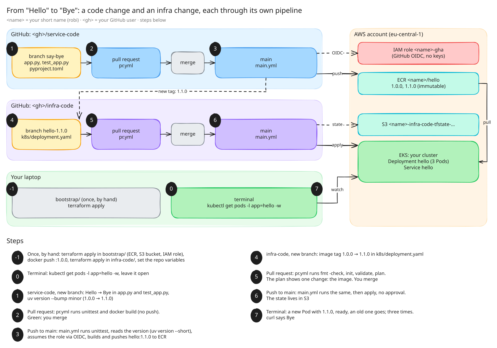

# CI/CD for the code and for the infrastructure

**DevOps Career Starter Kit** · Tuesday, 2026-11-10, 17:00–19:00

Last week a new image reached the cluster because someone edited a YAML and ran `kubectl apply` by
hand. Today that last step gets a pipeline too. You build two repositories from scratch, each with
its own pull-request checks and its own main-branch pipeline, then change one word and watch it
reach your EKS cluster without touching `kubectl apply`.



([`diagram/pipeline.excalidraw`](diagram/pipeline.excalidraw): open it on excalidraw.com to zoom
or draw on it.)

## What you get, what you write

| | given, in this repo | you write |
|---|---|---|
| `<gh>/service-code` | [`service-code/`](service-code): a Flask app, its tests, `pyproject.toml`, `uv.lock` | `Dockerfile`, `.github/workflows/pr.yml`, `.github/workflows/main.yml` |
| `<gh>/infra-code` | [`infra-code/`](infra-code): Terraform that turns every file in `k8s/` into a Kubernetes object, and `bootstrap/` for the AWS side | `.github/workflows/pr.yml`, `.github/workflows/main.yml` |

You need: your own EKS cluster (from the earlier weeks), AWS CLI v2, Terraform ≥ 1.10, Docker,
`kubectl`, `uv`, and a GitHub account. Region: `eu-central-1`.

Names used everywhere: `<name>` is your short name (`robi`), `<gh>` your GitHub user name. The
repos must be called exactly `service-code` and `infra-code`: the IAM role only trusts those two.

Solutions are in [`solution/`](solution). Try first, peek when stuck.

## -1. Set it up by hand, once

Everything works manually before anything gets automated.

1. **Two empty public repos** on GitHub: `<gh>/service-code` and `<gh>/infra-code`. Copy this
   repo's `service-code/` and `infra-code/` into them (only the contents, not the folders), commit,
   push to `main`.
2. **Bootstrap AWS** from `infra-code/bootstrap/`. It creates the ECR repo, the S3 bucket for the
   Terraform state, and the IAM role the workflows will use:
   ```bash
   cd bootstrap
   cp terraform.tfvars.example terraform.tfvars   # fill in your name, GitHub user, cluster, profile
   terraform init
   terraform apply
   ```
   Note the three outputs: `ecr_repository_url`, `state_bucket`, `role_arn`.
3. **Fill in the `CHANGE-ME`s** in infra-code: `backend.tf` (bucket), `terraform.tfvars`
   (cluster) and `k8s/deployment.yaml` (`<name>` in the image). Commit and push.
4. **The first image, by hand**, from `service-code/`. Write the `Dockerfile` first.
   ```bash
   aws ecr get-login-password --profile <profile> | docker login --username AWS --password-stdin 362099375729.dkr.ecr.eu-central-1.amazonaws.com
   docker build --platform linux/amd64 -t <ecr_repository_url>:1.0.0 .
   docker push <ecr_repository_url>:1.0.0
   ```
5. **The first deploy, by hand**, from `infra-code/`:
   ```bash
   export AWS_PROFILE=<profile>
   terraform init
   terraform apply
   aws eks update-kubeconfig --name <cluster> --region eu-central-1
   kubectl get pods -l app=hello          # 3 Pods, Running
   kubectl port-forward svc/hello 8080:80 # in another terminal: curl localhost:8080
   ```
6. **Repository variables** (Settings → Secrets and variables → Actions → *Variables*, not
   secrets: none of these are secret):

   | repo | variable | value |
   |---|---|---|
   | service-code | `AWS_ROLE_ARN` | bootstrap output `role_arn` |
   | service-code | `ECR_REPOSITORY_URL` | bootstrap output `ecr_repository_url` |
   | infra-code | `AWS_ROLE_ARN` | bootstrap output `role_arn` |

<details>
<summary>Hint: the Dockerfile</summary>

- Start from `python:3.13-slim`, copy the `uv` binary in from `ghcr.io/astral-sh/uv:0.11`.
- Copy `pyproject.toml` and `uv.lock` first and `uv sync --locked --no-install-project`, then copy
  `app.py`. Why that order? Rebuild after changing only `app.py` and watch which layers are cached.
- The app listens on 8080.
- Python running as PID 1 ignores `SIGTERM`, so every old Pod would hang 30 seconds in
  `Terminating`. `STOPSIGNAL SIGINT` fixes it.
</details>

<details>
<summary>Hint: <code>bootstrap</code> fails</summary>

- `AccessDeniedException` on the access entry: your cluster's authentication mode must be `API` or
  `API_AND_CONFIG_MAP` (`aws eks describe-cluster --name <cluster> --query cluster.accessConfig`).
- Pods in `ImagePullBackOff`: the node role needs `AmazonEC2ContainerRegistryReadOnly`.
- `exec format error` in the Pod logs: you built on an ARM Mac without `--platform linux/amd64`.
</details>

## Write the pipelines

Four workflows. Open a pull request for each repo's workflows, so you see the PR checks run on the
PR that adds them.

### service-code

| file | trigger | does |
|---|---|---|
| `pr.yml` | `pull_request` to `main` | run the tests; build the image, don't push it |
| `main.yml` | `push` to `main` | run the tests; then build the image, tag it with the version from `pyproject.toml`, push it to ECR |

<details>
<summary>Hint: running the tests on the runner</summary>

`astral-sh/setup-uv@v10` installs `uv`, then `uv run python -m unittest -v`. `uv run` creates the
virtualenv from `uv.lock` by itself.
</details>

<details>
<summary>Hint: logging in to AWS without access keys (OIDC)</summary>

```yaml
permissions:
  contents: read
  id-token: write   # without this, GitHub won't give the job an OIDC token
steps:
  - uses: aws-actions/configure-aws-credentials@v6
    with:
      role-to-assume: ${{ vars.AWS_ROLE_ARN }}
      aws-region: eu-central-1
  - uses: aws-actions/amazon-ecr-login@v2
```

The role trusts the token only if it comes from `repo:<gh>/service-code:ref:refs/heads/main`. Look at
`bootstrap/main.tf`: what happens if `pr.yml` tries to log in?
</details>

<details>
<summary>Hint: the version as the image tag</summary>

`uv version --short` prints `1.0.0` from `pyproject.toml`. Pass it from one step to the next:

```yaml
- id: version
  run: echo "version=$(uv version --short)" >> "$GITHUB_OUTPUT"
- run: echo "the tag is ${{ steps.version.outputs.version }}"
```

(Node: `node -p "require('./package.json').version"` does the same.)

The ECR repo is `IMMUTABLE`: merge a change without bumping the version and the push fails with
*tag already exists*. That's the point: `1.0.0` always means the same image.
</details>

### infra-code

| file | trigger | does |
|---|---|---|
| `pr.yml` | `pull_request` to `main` | `terraform fmt -check`, `init`, `validate`, `plan` |
| `main.yml` | `push` to `main` | the same, then `apply` without asking |

<details>
<summary>Hint: Terraform on the runner</summary>

- Same AWS login as in service-code. The role trusts `repo:<gh>/infra-code:pull_request` (plan) and
  `repo:<gh>/infra-code:ref:refs/heads/main` (apply).
- `hashicorp/setup-terraform@v4` installs Terraform. The AWS CLI is already on `ubuntu-latest`, and
  the Kubernetes provider uses it (`aws eks get-token`) to log in to the cluster.
- No `AWS_PROFILE` on the runner: the credentials come from the login step as environment variables.
- `-input=false` everywhere: nobody is there to type an answer.
- `terraform plan -out=tfplan`, then `terraform apply tfplan`: it applies exactly what was planned,
  and doesn't ask, because a saved plan is already approved.
- The state is in S3, so your laptop and the runner see the same thing. Two runs at once wait for
  each other (`use_lockfile`).
</details>

## The loop: say bye

0. **Terminal 1, keep it open:**
   ```bash
   kubectl get pods -l app=hello -w -o custom-columns='POD:.metadata.name,IMAGE:.spec.containers[0].image,READY:.status.containerStatuses[0].ready'
   ```
1. **service-code**, on a new branch: `Hello` → `Bye` in `app.py`. Bump the version:
   `uv version --bump minor` (1.0.0 → 1.1.0). Push the branch.
2. **Pull request.** The checks run. Red? Read it, fix it (did you change the test too?). Green:
   review your own diff, merge.
3. **`main.yml` runs**, and pushes `…/hello:1.1.0` to ECR. Check it in the ECR console or
   `aws ecr list-images --repository-name <name>/hello`.
4. **infra-code**, on a new branch: in `k8s/deployment.yaml`, image tag `1.0.0` → `1.1.0`. Push the
   branch.
5. **Pull request.** The plan shows exactly one change: the image of `kubernetes_manifest.k8s["deployment.yaml"]`.
   Merge.
6. **`main.yml` runs** plan and apply.
7. **Terminal 1:** a new Pod with `1.1.0`, it gets ready, an old one goes; three times.
   `curl localhost:8080` (after a new `kubectl port-forward svc/hello 8080:80`) says Bye.

Nobody ran `kubectl apply`. Everything that changed is a commit, in a PR, with a check next to it.

**Try next:** set `replicas: 6` the same way. Break it on purpose: `1.2.0` in the YAML that was never
pushed. What does the plan say, what does apply say, what does Terminal 1 show? Then fix it with
another PR.

## Clean up

```bash
cd infra-code && terraform destroy               # the Deployment and the Service
cd bootstrap && terraform destroy                # ECR (with the images), the state bucket, the role
```
